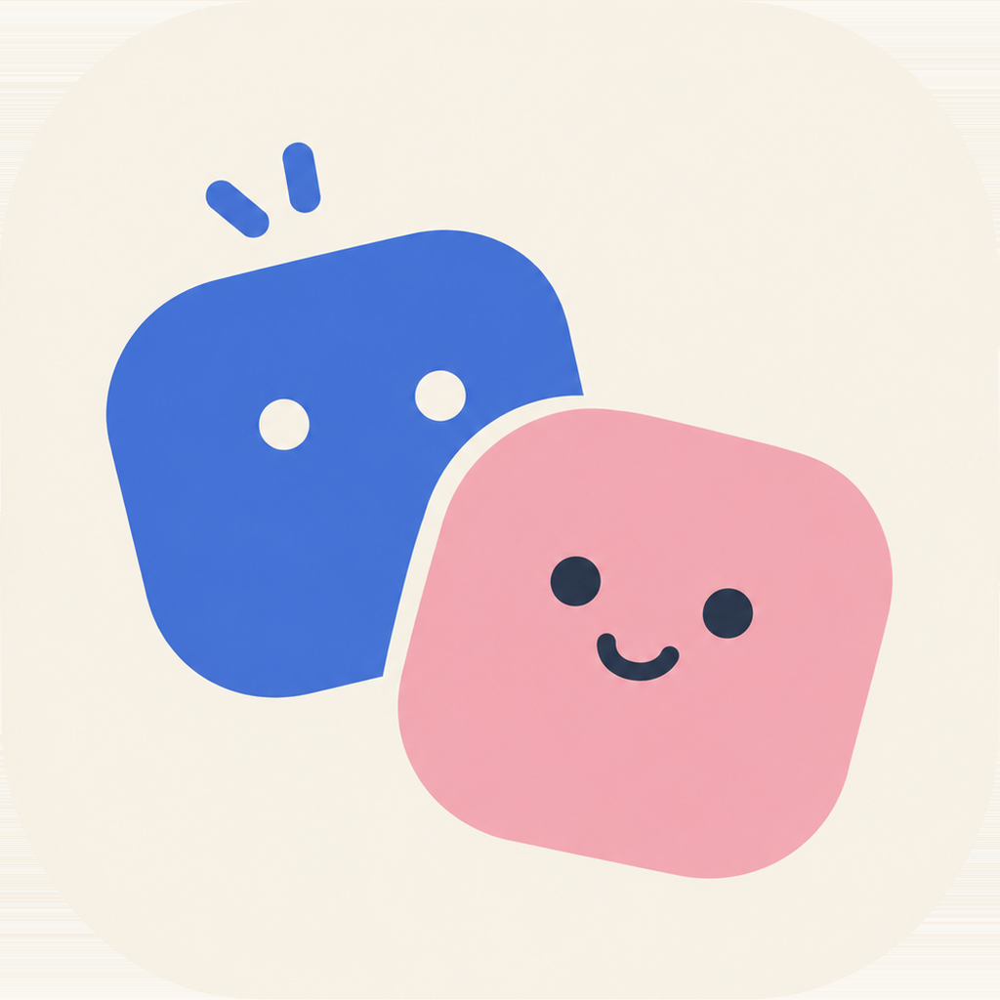
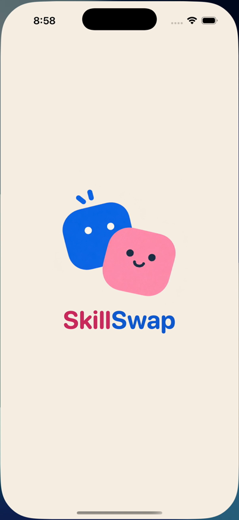
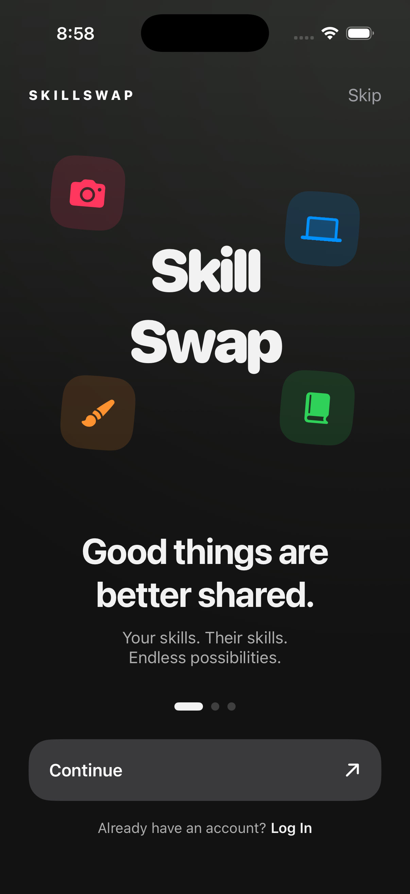

<p align="center">
  
</p>
<h1 align="center">SkillSwap</h1>
<p align="center"><strong>Made by students, for students.</strong></p>
<p align="center">CS 388T · Princess Nourah bint Abdulrahman University (PNU)</p>

SkillSwap is an iOS app for university students who want to learn from one another. Students list the skills they can teach and the skills they want to learn, find potential partners, and arrange an exchange without payment.

<p align="center">
  
  
</p>

<p align="center"><sub>Native launch screen and signed-out onboarding, captured on iPhone 17 Pro Simulator.</sub></p>

## How SkillSwap works

1. **Create a profile.** Sign in, add the skills you can teach and want to learn, and set your availability and discovery preference.
2. **Find a partner.** Explore featured skills or filter the student directory. Mutual matching uses shared skill catalog IDs in both directions. Save interesting profiles for later.
3. **Arrange an exchange.** Send a request from another student's profile. Accepted exchanges support session proposals, confirmation, cancellation, and rescheduling. In-app notifications open the relevant exchange when available.
4. **Start a conversation.** Open a student's profile or use **Connect** on a Community post. First contact starts with an introduction. Accepted conversations support private text messaging, mute, and per-user hiding from the inbox.
5. **Share with the community.** Publish, edit, and delete your own questions, resources, projects, and tips. Discover posts by skill, save them privately, and browse authors' posts under **Community & Work**.

**Technology.** Swift and SwiftUI for iOS, the Supabase Swift SDK for client access, Supabase Auth for email authentication, and PostgreSQL for application data and access policies.

## Build and run

**Requirements.** A Mac with Xcode 26.6 and an iOS 26.5 or later simulator runtime. The verified simulator configuration uses **iPhone 17 Pro** on iOS 26.5. Xcode resolves dependencies from the checked-in [Swift package lockfile](SkillSwap.xcodeproj/project.xcworkspace/xcshareddata/swiftpm/Package.resolved).

1. Open [SkillSwap.xcodeproj](SkillSwap.xcodeproj) in Xcode and allow Swift Package Manager to resolve the dependencies.
2. Select the **SkillSwap** scheme and **iPhone 17 Pro** simulator.
3. Choose **Product → Run**. Sign in using a designated account provided separately by the team for the demo.

From the repository root, the equivalent Debug build is:

```sh
xcodebuild -project SkillSwap.xcodeproj -scheme SkillSwap \
  -configuration Debug \
  -destination 'platform=iOS Simulator,name=iPhone 17 Pro' \
  build
```

### Supabase configuration

The university demo uses the existing configured Supabase backend. The current client reads the project URL and **publishable key** from [SupabaseManager.swift](SkillSwap/SupabaseManager.swift). The client has no environment-variable loader. These placeholders show the values the client needs if it is pointed at another provisioned project:

```text
Supabase project URL: https://YOUR_PROJECT_REF.supabase.co
Supabase publishable key: sb_publishable_YOUR_PUBLIC_KEY
```

Use only a client publishable key. Keep database passwords, service-role keys, private exports, and test account credentials outside the repository.

| SQL group | Purpose |
| --- | --- |
| Reviewed changes | [Exchange and scheduling 01–04](supabase/phase3_drafts/README.md), [messaging 05–08 and 10](supabase/messaging/README.md), [discoverability 11](supabase/discoverability/README.md), and [Community 12](supabase/community/README.md) document changes for an existing compatible database. Some reviewed files are under a directory named `drafts`. |
| Legacy and reference SQL | [Legacy profile setup](supabase/profiles_setup.sql), historical `phase*.sql` files, test fixtures, and inspection queries record earlier schema assumptions or verification steps. The legacy profile setup can replace policies and the Auth trigger. |
| Deferred drafts | [Moderation 08b](supabase/messaging/drafts/08b_chat_moderation.sql) and [private chat attachments 09](supabase/messaging/drafts/09_private_chat_attachments.sql) are retained for review. They are outside the hosted demo. |
| Fresh-project baseline | The repository has no complete, verified bootstrap for a new Supabase project. The reviewed migrations depend on the existing baseline, including normalized profiles, skill catalog and skill links, availability, Auth integration, Storage configuration, and their policies. Provision and verify that baseline separately before using these migrations in a new environment. |

## Professor demo walkthrough

Use the two designated test accounts and prepare a reciprocal skill match, an active exchange, an accepted conversation, and a published post before the demonstration.

1. **Home → Explore.** Show real recommendations, then search for a shared skill and enable **Mutual Matches Only**. Open the matching student's profile.
2. **Exchanges.** Show Incoming and Outgoing, then open an accepted exchange and its session details. Use the designated pair to demonstrate a proposal and confirmation when both sessions are available.
3. **Chats.** Open the existing conversation and show the message history. If a prepared first-contact pair is available, demonstrate an introduction and the recipient's response.
4. **Community.** Open **Home → Community for You → See All**. Show a post, save it, open **Profile → Saved → Posts**, and use **Connect** on another student's post.
5. **Notifications.** Open a prepared exchange notification and return to the notification list from the linked exchange.

The Debug build exposes student reporting and a **synthetic Moderator Demo**. Hosted administrator review, warnings and suspensions, private chat attachments, remote push notifications, and proactive session reminders are outside the demo. Full hosted two-account acceptance remains open for some exchange, messaging, and Community privacy scenarios.

## Project team

- Deena Ibrahim Aljeraiwi
- Fahdah Jalawi Al Saud
- Sadeem Alshahrani
- Sadeem Saud Alotaibi

Developed for **CS 388T** at **Princess Nourah bint Abdulrahman University**.
